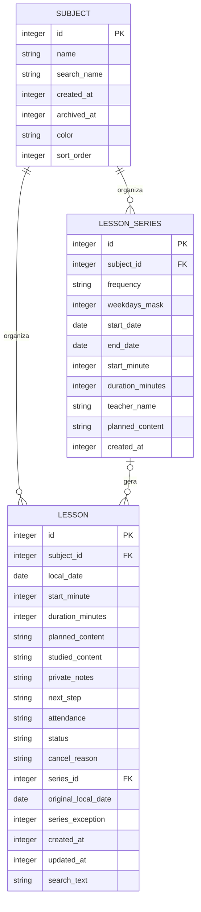

# App móvel — estratégia offline-first

**Estado:** fundação local e todo o código da Fase 1 implementados (esquema SQLite v4: edição de séries, feriados, período no histórico, cor/ordem de matérias, apontamentos e próximo passo, calendário mensal, cópia de segurança e eliminação total); validação em dispositivo ainda pendente. **Objetivo:** agenda e diário de aulas úteis em modo avião, para aluno que frequenta várias matérias e pode ter muitas aulas num dia.

## Decisões da fundação

1. **Aparelho primeiro:** SQLite local é a fonte de verdade. Nenhum fluxo de aula depende de rede, sessão, conta ou servidor.
2. **Banco relacional pequeno:** matérias são linhas próprias; cada ocorrência de aula liga à matéria. Horários são guardados como data civil local e minutos desde meia-noite, evitando conversões UTC que mudem o dia/horário escolar. A aritmética de datas (`src/features/lessons/domain.ts`) corre em UTC sobre datas civis, para que mudanças de hora de verão nunca desloquem um dia.
3. **Acesso limitado:** a agenda lê uma semana (segunda a domingo, navegável) e no máximo 100 ocorrências. O calendário mensal faz uma única consulta agrupada por dia sobre a grelha (no máximo 42 dias/62 linhas), sem carregar as aulas. O ecrã de histórico pede páginas de 30 linhas (máximo do repositório: 100) com cursor composto `(local_date, start_minute, id)`. O aviso de sobreposição lê só colunas numéricas, até 2000 linhas no intervalo afetado. Matérias: até 200 linhas. Não carregar todo o histórico em memória.
4. **Sem ficheiros pesados no banco:** texto curto fica no SQLite (conteúdos, apontamentos e próximo passo até 2000 caracteres cada, nomes até 80); fotos e PDFs não são armazenados em BLOB/base64. Anexos só entram depois com armazenamento no sistema de ficheiros, miniaturas sob demanda e política explícita de cópia de segurança.
5. **Sem expiração automática:** faltas, aulas e anotações escolares não são apagadas para “limpar” o app. Excluir uma aula é sempre uma ação do aluno com confirmação explícita; arquivar uma matéria não apaga aulas. Exportar, restaurar e apagar todos os dados são ações iniciadas e confirmadas pelo aluno (ver “Cópia de segurança, restauro e eliminação”). Leveza vem de consultas paginadas, índices seletivos, listas virtualizadas e evitar imagens pesadas, não de perder histórico.
6. **Escritas pequenas:** cada ação é uma transação SQLite breve; as maiores são a criação ou extensão de uma repetição (até 300 inserções com instrução preparada numa transação), “editar todas as futuras” e o cancelamento de um feriado/pausa (um único `UPDATE` cada) e o restauro de uma cópia de segurança, uma ação rara e explícita (até 30 000 aulas numa transação, ver abaixo). Agenda ordenada e filtros usam índices. WAL permite leitura concorrente com gravações. Cache SQLite do processo é limitado a cerca de 4 MiB neste perfil inicial; medir em aparelhos antes de alterar.
7. **Evolução sem acoplar ao servidor:** regras de domínio puras (`domain.ts`), repositórios (`repository.ts`) e ecrãs (`src/screens`) vivem separados; a interface não executa SQL. A sincronização futura deverá ser uma camada explícita com outbox idempotente, IDs estáveis, resolução de conflitos e consentimento; não uma chamada de rede escondida na gravação local.
8. **Preferências leves:** idioma (pt-BR, pt-PT, en, es) e tema (sistema, claro, escuro) são pequenas chaves locais via `expo-sqlite/kv-store`, sem uma segunda infraestrutura de estado.

## Modelo de dados (esquema v4)



- `attendance` (`unmarked`/`attended`/`absent`) registra somente a perspectiva local do aluno. Para colaboração futura, será substituído/expandido por registros de presença com autoria e confirmação independente; uma pessoa não pode declarar como fato a falta da outra.
- `status` (`planned`/`cancelled`) é o estado da aula, separado da presença. Cancelar limpa a presença para `unmarked` e o repositório recusa presença em aula cancelada: cancelamento nunca conta como falta (nem como presença). Reativar volta a `planned` sem inventar presença.
- `planned_content` (plano), `studied_content` (o que foi realmente estudado), `private_notes` (apontamentos privados) e `next_step` (próximo passo/tarefa) são campos distintos; os três últimos são preenchidos na edição. O cartão da agenda/histórico mostra o próximo passo, mas nunca os apontamentos privados (para não ficarem visíveis a quem olha para a lista).
- `lesson_series.teacher_name`/`planned_content` (v4) são o modelo da série: valores usados ao estender a série e atualizados por “todas as futuras”. `lessons.series_exception` (0/1) marca a ocorrência editada à parte (campo governado diferente do modelo); edições da série nunca lhe tocam.
- `subjects.color` guarda uma chave da paleta fixa (`green`, `blue`, `purple`, `red`, `orange`, `teal`, `pink`, `gray`; valores por tema em `src/theme/palette.ts`, contraste ≥ 4,8:1 com fundo e superfície) e `subjects.sort_order` a ordem manual (NULL = nunca movida, segue por nome).
- `lesson_series` guarda a regra semanal/quinzenal (máscara de dias: bit 0 = domingo … bit 6 = sábado) e o intervalo; as ocorrências são materializadas como linhas de `lessons` com `series_id` e `original_local_date`. Quinzenal conta semanas (segunda a domingo) a partir da semana da data inicial: semanas 0, 2, 4…
- `subjects.search_name` e `lessons.search_text` (v3) são chaves de pesquisa derivadas, calculadas pela app (ver “Histórico e pesquisa local”); não entram na cópia de segurança e são recalculadas no restauro.
- `subjects.archived_at` esconde a matéria das sugestões sem tocar nas aulas; voltar a usar o mesmo nome numa aula reativa-a. Nomes de matéria são únicos sem diferenciar maiúsculas (ASCII).

### Migrações

`src/db/migrations.ts` (sem dependências do Expo) aplica, numa única transação, os passos em falta até `SCHEMA_VERSION = 4` e grava `PRAGMA user_version` no fim; uma falha desfaz tudo e a versão anterior continua intacta. Os PRAGMAs de ligação (WAL, chaves estrangeiras, cache) correm antes, fora da transação, em `src/db/database.ts`.

- **v1:** `subjects`, `lessons`, índices `lessons_date_time_idx` e `lessons_subject_date_idx`.
- **v2 (aditiva):** cria `lesson_series`; `ALTER TABLE lessons ADD COLUMN` `status` (default `planned`, CHECK), `cancel_reason`, `series_id` (FK `ON DELETE SET NULL`), `original_local_date`, `updated_at`; `ALTER TABLE subjects ADD COLUMN archived_at`; índice parcial `lessons_series_date_idx (series_id, local_date) WHERE series_id IS NOT NULL`. Nenhuma linha existente é reescrita ou apagada; os defaults preenchem as aulas antigas.
- **v3 (aditiva):** `ALTER TABLE subjects ADD COLUMN search_name TEXT` e `ALTER TABLE lessons ADD COLUMN search_text TEXT`, seguidos de backfill em páginas de 500 linhas por `id` (nunca o histórico inteiro em memória), dentro da mesma transação. O SQLite não tem função para retirar acentos e a API do expo-sqlite usada aqui não regista funções SQL próprias, por isso a normalização é feita em JavaScript (`src/lib/text.ts`). Só as colunas novas são escritas.
- **v4 (aditiva):** `ALTER TABLE … ADD COLUMN` `subjects.color`, `subjects.sort_order`, `lesson_series.teacher_name`, `lesson_series.planned_content`, `lessons.private_notes`, `lessons.next_step` e `lessons.series_exception` (default 0, CHECK 0/1). Em seguida `deriveSeriesState` (SQL estático): o modelo de cada série recebe professor/plano da primeira ocorrência nunca editada (`updated_at` = `created_at`), ou da primeira ocorrência; ocorrências cujo horário, duração, matéria, data (≠ data original), professor ou plano diferem do modelo ficam marcadas como editadas à parte. Só as colunas novas são escritas; nenhuma linha é apagada. A chave de pesquisa passa a incluir apontamentos e próximo passo, mas as linhas antigas não precisam de backfill (os campos novos estão vazios).
- Uma base com `user_version` maior do que a app conhece é recusada; nunca se apaga a base para contornar um erro de migração.
- `npm test` executa estas migrações contra `node:sqlite` (SQLite 3.53 do Node 24): base nova, upgrade v1→v2, v2→v3 (com mais de uma página de backfill) e v3→v4 com dados preservados coluna a coluna e derivação do modelo/exceções, rollback com falha injetada em v2, v3 e v4 e recusa de versão futura. **Ainda falta** confirmar o mesmo no SQLite do expo-sqlite em Android/iOS, com bases v1/v2 criadas pelas versões anteriores da app.

### Repetições: o que é e não é suportado

| Ação | Suportado | Notas |
|---|---|---|
| Criar repetição semanal/quinzenal | Sim | Dias da semana + data final; até 1 ano e 300 aulas; tudo numa transação. Guarda professor e plano como modelo. |
| Editar uma ocorrência | “Só esta” | Mantém `series_id` e `original_local_date`; se horário, duração, professor, plano, matéria ou data ficarem diferentes do modelo, a ocorrência fica marcada como editada à parte. |
| Editar todas | “Todas as futuras” | Só quando muda horário, duração, professor ou plano (mesma data e matéria). Atualiza o modelo e, num único `UPDATE` numa transação, as ocorrências **futuras** (ainda não começadas segundo o relógio do aparelho), **planeadas**, **sem registo** (sem presença, estudado, apontamentos ou próximo passo) e **não editadas à parte**. Passadas, registadas, canceladas e editadas à parte nunca mudam. O diálogo mostra quantas mudam e verifica sobreposições em todas as datas. |
| Alterar a data final | Sim | Pré-visualização com contagens e confirmação. Estender: cria, a partir do modelo, as datas da regra depois da data final antiga que ainda são futuras e não existem (por data original) — repetir não duplica e aulas apagadas antes da data final antiga não ressuscitam. Encurtar: apaga só ocorrências futuras e intactas depois da nova data; o resto fica. Limites de 1 ano e 300 aulas sobre a regra inteira. Uma transação. |
| Cancelar | “Só esta” ou “esta e as seguintes” | Seguintes = mesma série com data ≥ à da aula escolhida. |
| Excluir | “Só esta” ou “esta e as seguintes” | Com confirmação; a data final da série é encurtada e a série sem aulas é removida. |
| Feriado/pausa | Sim (por período) | Ver “Feriados e pausas”. |
| Mudar dias da semana ou frequência de uma série | **Não** | Encurtar a série e criar uma nova repetição. |
| Aviso de sobreposição ao estender | **Não** | Estender não verifica sobreposições das datas criadas. |

### Feriados e pausas

Na agenda, “Feriado ou pausa” pede um intervalo (De/Até, inclusivo, até 1 ano) e um motivo opcional. Primeiro conta as aulas **planeadas e sem registo** (sem presença e sem conteúdo estudado) no intervalo e mostra essa contagem num alerta; só depois de confirmar as cancela todas com o motivo, num único `UPDATE` dentro de uma transação. Cancelada não é falta nem presença; cada aula pode ser reativada individualmente. Aulas com presença ou estudado registados não mudam. Repetir a mesma pausa não encontra nada novo.

### Calendário mensal

“Mês” na agenda abre uma grelha de semanas completas (segunda a domingo, 4–6 linhas) com o número de aulas planeadas por dia e “−N” para canceladas; a cor nunca é a única pista e cada dia tem um rótulo falado completo. Tocar num dia abre a semana correspondente na agenda. Os dados vêm de `countLessonsByDay` (uma consulta `GROUP BY local_date` limitada a 62 linhas).

### Aviso de sobreposição

Antes de guardar, o editor compara a aula (ou todas as datas da repetição) com as aulas não canceladas do mesmo dia; intervalos que apenas se tocam (15:00–16:00 e 16:00–17:00) não contam. O aviso mostra quantos casos existem e deixa “Guardar mesmo assim” ou “Rever”; nunca bloqueia.

### Histórico e pesquisa local

O histórico mostra aulas até hoje (as futuras ficam na agenda), da mais recente para a mais antiga. O filtro “Período” (De/Até, inclusivo, cada lado opcional) combina com a matéria e a pesquisa, só é aplicado quando as datas são válidas e nunca mostra datas futuras (o limite superior é o menor entre a data final e hoje); a paginação por cursor mantém-se. As páginas só crescem quando o aluno toca “Carregar mais”; a `FlatList` virtualiza a renderização, mas as páginas carregadas ficam em memória até mudar o filtro (descartar páginas distantes fica para quando houver medição em aparelho).

Pesquisa em matéria, professor, conteúdo planeado e estudado, apontamentos privados e próximo passo sem distinguir acentos nem maiúsculas: “FISICA”, “física” e “Física” são equivalentes. A app guarda chaves normalizadas (minúsculas, sem marcas diacríticas via `normalize('NFD')`, espaços colapsados; tabela de recurso para letras latinas comuns se `normalize` faltar) em `subjects.search_name` e em `lessons.search_text` (professor, previsto, estudado, apontamentos e próximo passo separados por quebra de linha, para um termo nunca casar entre dois campos). Toda a escrita que muda esses textos (criar, editar, editar todas as futuras, estender série, renomear matéria, restaurar) atualiza a chave na mesma transação. O termo digitado recebe a mesma normalização, é limitado a 100 caracteres e vai como `LIKE ? ESCAPE '\'` com `%`, `_` e `\` escapados. Os filtros opcionais usam parâmetros (`? IS NULL OR …`), nunca SQL concatenado. `LIKE '%termo%'` não usa índice (percorre as linhas até hoje, página a página); FTS fica para depois de medir volume real. Letras como `ß`, `ø` ou `æ` não são decompostas e só casam consigo próprias.

## Cópia de segurança, restauro e eliminação

Implementado em `src/features/backup/` (formato e validação puros em `format.ts`, SQL em `repository.ts`, ficheiros e partilha em `files.ts`) e na secção “Os seus dados” das definições (`src/screens/DataSettings.tsx`).

**Formato** (JSON, UTF-8, uma linha):

```json
{ "format": "aula-em-dia.backup", "schema_version": 4, "exported_at": "2026-10-21T12:00:00.000Z",
  "subjects": [{ "id": 1, "name": "Física", "created_at": 0, "archived_at": null, "color": "blue", "sort_order": 1 }],
  "lesson_series": [{ "id": 1, "subject_id": 1, "frequency": "weekly", "weekdays_mask": 2, "start_date": "2026-10-05", "end_date": "2026-12-14", "start_minute": 600, "duration_minutes": 50, "created_at": 0, "teacher_name": null, "planned_content": null }],
  "lessons": [{ "id": 1, "subject_id": 1, "teacher_name": null, "local_date": "2026-10-05", "start_minute": 600, "duration_minutes": 50, "planned_content": null, "studied_content": null, "attendance": "unmarked", "status": "planned", "cancel_reason": null, "series_id": 1, "original_local_date": "2026-10-05", "created_at": 0, "updated_at": null, "private_notes": null, "next_step": null, "series_exception": 0 }] }
```

**Compatibilidade:** a app exporta sempre `schema_version` 4 e continua a aceitar cópias `schema_version` 3 (versão anterior). Cada versão tem um conjunto de chaves exato: uma cópia v3 não pode ter chaves v4 e uma v4 tem de as ter todas. Ao restaurar uma cópia v3, os campos novos ficam vazios (sem cor, sem ordem, sem apontamentos) e o modelo das séries e as marcas “editada à parte” são derivados como na migração v4. Cópias < 3 ou > 4 são recusadas.

As chaves são os nomes das colunas. Ficam de fora as colunas derivadas (`search_*`) e as preferências do aparelho (idioma, tema). Não há credenciais no ficheiro, mas ele contém todo o diário do aluno em texto simples, sem cifra: quem o recebe consegue lê-lo.

**Exportar:** `exportBackup` lê numa transação, em páginas de 500 linhas por `id`, e recusa (sem truncar) se houver mais de 2 000 matérias, 5 000 séries ou 30 000 aulas, ou se o JSON passar de 10 milhões de caracteres. O documento e o texto JSON ficam inteiros em memória durante a exportação; com conteúdos médios de ~200 caracteres, 30 000 aulas dão uma ordem de 10–15 MB de texto, valor estimado e **não medido em aparelho**. O ficheiro é escrito em `cache/backup-export/` e aberto na folha de partilha do sistema (`expo-sharing`, instalado com `npx expo install` junto com `expo-file-system`; o `Share` do React Native foi descartado porque passa o texto pelo intent do Android, que falha com conteúdos acima de ~1 MB). A cópia fica na cache privada da app até à exportação seguinte ou a “Apagar todos os meus dados” (as apps de destino podem lê-la depois de a folha fechar); o sistema pode limpá-la antes.

**Restaurar:** o aluno cola o JSON num campo de texto ou escolhe o ficheiro (seletor do `expo-file-system`). `validateBackup` rejeita o documento inteiro se: não for JSON; `format` não corresponder; `schema_version` for maior do que o da app (nunca se importa para um esquema mais recente) ou menor do que 3; houver chaves a mais ou em falta; tipos, enumerações, datas `AAAA-MM-DD` reais, minutos 0–1439, durações 5–480, máscara 1–127, `end_date ≥ start_date`, comprimentos (nomes 80, conteúdos/apontamentos/próximo passo 2000, motivo 160, sem NUL), cor fora da paleta, ordem fora de 0–1 000 000, `series_exception` diferente de 0/1 (ou 1 sem série) ou carimbos inteiros falharem; houver `id` repetido, nome de matéria repetido (sem distinguir maiúsculas ASCII, como o `NOCASE` da base) ou referência a matéria/série inexistente; ou se uma aula cancelada tiver presença ou uma aula planeada tiver motivo de cancelamento. A interface mostra a data da cópia e as contagens, as contagens atuais que serão substituídas, e pede confirmação num alerta. `restoreBackup` aceita só um documento validado, confirma que a base está no esquema da app e, numa única transação, apaga as três tabelas, insere tudo com instruções preparadas (recalculando as chaves de pesquisa) e confere as contagens; qualquer erro faz rollback e os dados anteriores ficam intactos. Não existe importação parcial nem fusão.

**Apagar todos os meus dados:** dois alertas (resumo com contagens e sugestão de exportar → confirmação definitiva) e `deleteAllData` apaga aulas, séries e matérias numa transação. Depois, em melhor esforço, `VACUUM` e `PRAGMA wal_checkpoint(TRUNCATE)` retiram as páginas libertadas do ficheiro e do WAL, e a cópia exportada em cache é apagada. Idioma e tema mantêm-se. Nada disto apaga cópias que o aluno já tenha partilhado com outras apps nem backups do sistema operativo.

**Limites conhecidos:** colar vários MB num `TextInput` pode ser lento ou ser cortado pela área de transferência; para cópias grandes, usar “Escolher ficheiro”. O seletor de ficheiros, a folha de partilha e `String.prototype.normalize` no Hermes ainda não foram ensaiados em aparelho.

## Guardrails de crescimento

- Não usar `SELECT *`, resultados sem limite ou consultas por item em loop.
- Todas as entradas SQL usam placeholders; texto de utilizador nunca compõe SQL.
- Índices só nas chaves e filtros usados (`local_date/start_minute`, `subject_id/local_date`, `series_id/local_date` parcial); revisar plano com volume real antes de adicionar índices.
- Evitar guardar estado derivável ou duplicar títulos das matérias em cada aula.
- Nunca manter duas cópias globais do histórico em estado React; carregar páginas sob pedido.
- Não usar polling, analytics ou sincronização automática na fase sem nuvem.
- Não compactar ou eliminar histórico silenciosamente. `wal_checkpoint(PASSIVE)` é uma operação eventual de manutenção, não uma política de apagar informação.
- Investigar consumo real com profiling no Android e Instruments no iOS após instalar em aparelhos; metas de memória/armazenamento ainda não foram medidas e não devem ser inventadas.

## Segurança, privacidade e recuperação

Os dados ficam dentro do sandbox da aplicação e a instalação atual não envia registos. SQLite não está criptografado por esta configuração; não anunciar proteção criptográfica adicional. Antes de guardar informação particularmente sensível ou oferecer contas de menores, rever proteção de ficheiros do iOS/Android, bloqueio do dispositivo, exportação, cópia de segurança e eliminação. A desinstalação ou perda do telefone apaga os dados se o aluno não tiver exportado uma cópia; a exportação/restauro local já existe, mas não há cópia automática. O ficheiro exportado não é cifrado.

## Incrementos seguintes

1. Ensaiar a Fase 1 completa em Android e iPhone (checklist em `docs/qa-mobile.md`), incluindo atualização de bases v1/v2/v3 para v4.
2. Seletores nativos de data/hora; aviso de sobreposição ao estender uma série; mudar dias/frequência de uma série existente.
3. Lembrete opcional para exportar, cópia cifrada com palavra-passe e ensaio de exportação/restauro com volume grande em aparelho.
4. Profiling de memória, desempenho e base com conjuntos grandes gerados localmente; medir Android e iOS.
5. Apenas após uma decisão explícita: conta opcional, backup cloud e sincronização idempotente com conflitos visíveis, mantendo a app operável em modo avião.

## Verificação

- `npm run typecheck` (app e ficheiros de teste) e `npm test` devem passar.
- `npx expo-doctor` deve confirmar compatibilidade do SDK.
- `npx expo export --platform android --platform ios` deve gerar os dois bundles.
- Validar manualmente criação e leitura em Android e iPhone reais/emulados, alternando modo avião e reiniciando a aplicação.
- A compilação local para iOS não pode ser feita nesta máquina Windows; a geração/instalação Android depende de SDK ou Expo Go.
