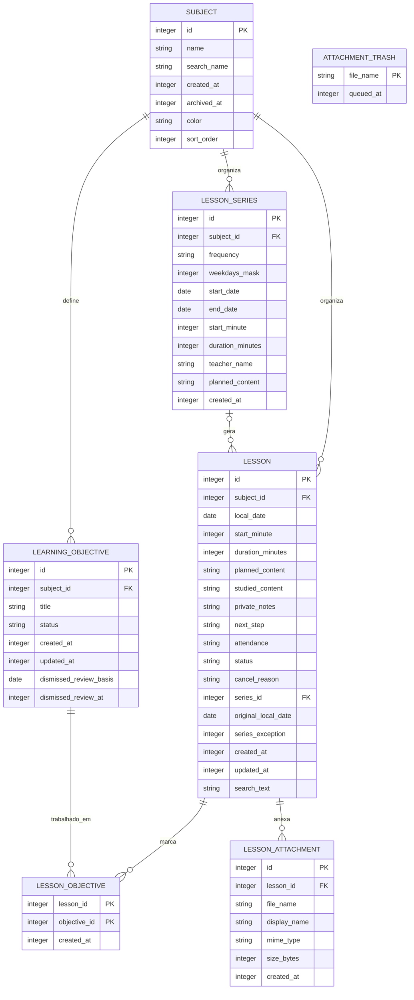

# App móvel — estratégia offline-first

**Estado:** fundação local, todo o código da Fase 1 e o apoio à aprendizagem implementados (esquema SQLite v6: edição de séries, feriados, período no histórico, cor/ordem de matérias, apontamentos e próximo passo, calendário mensal, objetivos de aprendizagem com marcação nas aulas e sugestões de revisão explicáveis, cópia de segurança v5, exportação CSV do histórico, eliminação total, anexos de aula em ficheiros locais e uma revisão de acessibilidade no código); validação em dispositivo ainda pendente. **Objetivo:** agenda e diário de aulas úteis em modo avião, para aluno que frequenta várias matérias e pode ter muitas aulas num dia.

## Decisões da fundação

1. **Aparelho primeiro:** SQLite local é a fonte de verdade. Nenhum fluxo de aula depende de rede, sessão, conta ou servidor.
2. **Banco relacional pequeno:** matérias são linhas próprias; cada ocorrência de aula liga à matéria. Horários são guardados como data civil local e minutos desde meia-noite, evitando conversões UTC que mudem o dia/horário escolar. A aritmética de datas (`src/features/lessons/domain.ts`) corre em UTC sobre datas civis, para que mudanças de hora de verão nunca desloquem um dia.
3. **Acesso limitado:** a agenda lê uma semana (segunda a domingo, navegável) e no máximo 100 ocorrências. O calendário mensal faz uma única consulta agrupada por dia sobre a grelha (no máximo 42 dias/62 linhas), sem carregar as aulas. O ecrã de histórico pede páginas de 30 linhas (máximo do repositório: 100) com cursor composto `(local_date, start_minute, id)`. O aviso de sobreposição lê só colunas numéricas, até 2000 linhas no intervalo afetado. Matérias: até 200 linhas. Objetivos: até 200 por matéria; as sugestões de revisão leem no máximo 500 objetivos não concluídos. Anexos: até 10 por aula, lidos só quando o editor da aula é aberto. Não carregar todo o histórico em memória.
4. **Sem ficheiros pesados no banco:** texto curto fica no SQLite (conteúdos, apontamentos e próximo passo até 2000 caracteres cada, nomes até 80); fotos e PDFs nunca são armazenados em BLOB/base64. Os anexos (esquema v6) seguem esta regra: os bytes ficam em ficheiros no diretório de documentos da app, o SQLite guarda só metadados, não se geram miniaturas (a lista mostra nome, tipo e tamanho; abrir passa pela folha de partilha) e a política de cópia de segurança está explícita em “Anexos de aula”.
5. **Sem expiração automática:** faltas, aulas e anotações escolares não são apagadas para “limpar” o app. Excluir uma aula é sempre uma ação do aluno com confirmação explícita; arquivar uma matéria não apaga aulas. Exportar, restaurar e apagar todos os dados são ações iniciadas e confirmadas pelo aluno (ver “Cópia de segurança, restauro e eliminação”). Leveza vem de consultas paginadas, índices seletivos, listas virtualizadas e evitar imagens pesadas, não de perder histórico.
6. **Escritas pequenas:** cada ação é uma transação SQLite breve; as maiores são a criação ou extensão de uma repetição (até 300 inserções com instrução preparada numa transação), “editar todas as futuras” e o cancelamento de um feriado/pausa (um único `UPDATE` cada) e o restauro de uma cópia de segurança, uma ação rara e explícita (até 30 000 aulas numa transação, ver abaixo). Agenda ordenada e filtros usam índices. WAL permite leitura concorrente com gravações. Cache SQLite do processo é limitado a cerca de 4 MiB neste perfil inicial; medir em aparelhos antes de alterar.
7. **Evolução sem acoplar ao servidor:** regras de domínio puras (`domain.ts`), repositórios (`repository.ts`) e ecrãs (`src/screens`) vivem separados; a interface não executa SQL. A sincronização futura deverá ser uma camada explícita com outbox idempotente, IDs estáveis, resolução de conflitos e consentimento; não uma chamada de rede escondida na gravação local.
8. **Preferências leves:** idioma (pt-BR, pt-PT, en, es) e tema (sistema, claro, escuro) são pequenas chaves locais via `expo-sqlite/kv-store`, sem uma segunda infraestrutura de estado.

## Modelo de dados (esquema v6)



- `attendance` (`unmarked`/`attended`/`absent`) registra somente a perspectiva local do aluno. Para colaboração futura, será substituído/expandido por registros de presença com autoria e confirmação independente; uma pessoa não pode declarar como fato a falta da outra.
- `status` (`planned`/`cancelled`) é o estado da aula, separado da presença. Cancelar limpa a presença para `unmarked` e o repositório recusa presença em aula cancelada: cancelamento nunca conta como falta (nem como presença). Reativar volta a `planned` sem inventar presença.
- `planned_content` (plano), `studied_content` (o que foi realmente estudado), `private_notes` (apontamentos privados) e `next_step` (próximo passo/tarefa) são campos distintos; os três últimos são preenchidos na edição. O cartão da agenda/histórico mostra o próximo passo, mas nunca os apontamentos privados (para não ficarem visíveis a quem olha para a lista).
- `lesson_series.teacher_name`/`planned_content` (v4) são o modelo da série: valores usados ao estender a série e atualizados por “todas as futuras”. `lessons.series_exception` (0/1) marca a ocorrência editada à parte (campo governado diferente do modelo); edições da série nunca lhe tocam.
- `subjects.color` guarda uma chave da paleta fixa (`green`, `blue`, `purple`, `red`, `orange`, `teal`, `pink`, `gray`; valores por tema em `src/theme/palette.ts`, contraste ≥ 4,8:1 com fundo e superfície) e `subjects.sort_order` a ordem manual (NULL = nunca movida, segue por nome).
- `lesson_series` guarda a regra semanal/quinzenal (máscara de dias: bit 0 = domingo … bit 6 = sábado) e o intervalo; as ocorrências são materializadas como linhas de `lessons` com `series_id` e `original_local_date`. Quinzenal conta semanas (segunda a domingo) a partir da semana da data inicial: semanas 0, 2, 4…
- `subjects.search_name` e `lessons.search_text` (v3) são chaves de pesquisa derivadas, calculadas pela app (ver “Histórico e pesquisa local”); não entram na cópia de segurança e são recalculadas no restauro.
- `learning_objectives` (v5) guarda objetivos de aprendizagem por matéria: `title` (1–200 caracteres, uma linha), `status` escolhido pelo aluno (`open` aberto, `practising` a praticar, `done` concluído), `created_at`/`updated_at` e o par `dismissed_review_basis`/`dismissed_review_at` (data-base da sugestão de revisão que o aluno dispensou). Não há nota, pontuação nem campo de desempenho. FK para a matéria com `ON DELETE RESTRICT` (matérias só desaparecem na eliminação total/restauro, que apagam primeiro os objetivos).
- `lesson_objectives` (v5, `WITHOUT ROWID`, chave `(lesson_id, objective_id)` e índice `(objective_id, lesson_id)`) liga uma aula aos objetivos que o aluno marcou como trabalhados nela. Apagar uma aula (ação do aluno) remove só as suas marcas (`ON DELETE CASCADE`); o objetivo fica. Só se marcam objetivos da matéria da aula (`INSERT … SELECT` com a junção pela matéria); se a aula mudar de matéria na edição, as marcas da matéria antiga são retiradas na mesma transação.
- `lesson_attachments` (v6) guarda só metadados de cada anexo: `file_name` (nome UUID v4 gerado pela app, único, com extensão canónica), `display_name` (nome sanitizado, 1–120 caracteres), `mime_type` (detetado pelo conteúdo: `application/pdf`, `image/png`, `image/jpeg`, `image/webp`, `text/plain`; CHECK), `size_bytes` (1 B–5 MB; CHECK) e `created_at`. FK para a aula com `ON DELETE CASCADE`; índice `(lesson_id, id)`. `attachment_trash` (v6, `WITHOUT ROWID`) é a fila de ficheiros a apagar, preenchida por um trigger (ver “Anexos de aula”).
- `subjects.archived_at` esconde a matéria das sugestões sem tocar nas aulas; voltar a usar o mesmo nome numa aula reativa-a. Nomes de matéria são únicos sem diferenciar maiúsculas (ASCII).

### Migrações

`src/db/migrations.ts` (sem dependências do Expo) aplica, numa única transação, os passos em falta até `SCHEMA_VERSION = 8` e grava `PRAGMA user_version` no fim; uma falha desfaz tudo e a versão anterior continua intacta. Os PRAGMAs de ligação (WAL, chaves estrangeiras, cache) correm antes, fora da transação, em `src/db/database.ts`.

- **v1:** `subjects`, `lessons`, índices `lessons_date_time_idx` e `lessons_subject_date_idx`.
- **v2 (aditiva):** cria `lesson_series`; `ALTER TABLE lessons ADD COLUMN` `status` (default `planned`, CHECK), `cancel_reason`, `series_id` (FK `ON DELETE SET NULL`), `original_local_date`, `updated_at`; `ALTER TABLE subjects ADD COLUMN archived_at`; índice parcial `lessons_series_date_idx (series_id, local_date) WHERE series_id IS NOT NULL`. Nenhuma linha existente é reescrita ou apagada; os defaults preenchem as aulas antigas.
- **v3 (aditiva):** `ALTER TABLE subjects ADD COLUMN search_name TEXT` e `ALTER TABLE lessons ADD COLUMN search_text TEXT`, seguidos de backfill em páginas de 500 linhas por `id` (nunca o histórico inteiro em memória), dentro da mesma transação. O SQLite não tem função para retirar acentos e a API do expo-sqlite usada aqui não regista funções SQL próprias, por isso a normalização é feita em JavaScript (`src/lib/text.ts`). Só as colunas novas são escritas.
- **v4 (aditiva):** `ALTER TABLE … ADD COLUMN` `subjects.color`, `subjects.sort_order`, `lesson_series.teacher_name`, `lesson_series.planned_content`, `lessons.private_notes`, `lessons.next_step` e `lessons.series_exception` (default 0, CHECK 0/1). Em seguida `deriveSeriesState` (SQL estático): o modelo de cada série recebe professor/plano da primeira ocorrência nunca editada (`updated_at` = `created_at`), ou da primeira ocorrência; ocorrências cujo horário, duração, matéria, data (≠ data original), professor ou plano diferem do modelo ficam marcadas como editadas à parte. Só as colunas novas são escritas; nenhuma linha é apagada. A chave de pesquisa passa a incluir apontamentos e próximo passo, mas as linhas antigas não precisam de backfill (os campos novos estão vazios).
- **v5 (aditiva):** só `CREATE TABLE learning_objectives` (CHECKs de título 1–200 e estado), índice `learning_objectives_subject_idx (subject_id, status, id)`, `CREATE TABLE lesson_objectives` e índice `lesson_objectives_objective_idx`. Nenhuma linha ou coluna existente é lida, reescrita ou apagada; as tabelas novas começam vazias.
- **v6 (aditiva):** só `CREATE TABLE lesson_attachments` (CHECKs de tipo, tamanho e comprimentos; FK `ON DELETE CASCADE`), índice `lesson_attachments_lesson_idx`, `CREATE TABLE attachment_trash` e o trigger `lesson_attachments_to_trash` (`AFTER DELETE`, copia o nome do ficheiro para a fila). Nenhuma linha ou coluna existente é lida, reescrita ou apagada.
- Uma base com `user_version` maior do que a app conhece é recusada; nunca se apaga a base para contornar um erro de migração.
- `npm test` executa estas migrações contra `node:sqlite` (SQLite 3.53 do Node 24): base nova, upgrade v1→v2, v2→v3 (com mais de uma página de backfill), v3→v4 com dados preservados coluna a coluna e derivação do modelo/exceções, v4→v5 com todas as colunas v4 preservadas e restrições das tabelas novas, v5→v6 com todas as tabelas v5 preservadas linha a linha, restrições dos anexos e cascata da aula para a fila, rollback com falha injetada em v2, v3, v4, v5 e v6 e recusa de versão futura. **Ainda falta** confirmar o mesmo no SQLite do expo-sqlite em Android/iOS, com bases v1–v5 criadas pelas versões anteriores da app.

### Repetições: o que é e não é suportado

| Ação | Suportado | Notas |
|---|---|---|
| Criar repetição semanal/quinzenal | Sim | Dias da semana + data final; até 1 ano e 300 aulas; tudo numa transação. Guarda professor e plano como modelo. |
| Editar uma ocorrência | “Só esta” | Mantém `series_id` e `original_local_date`; se horário, duração, professor, plano, matéria ou data ficarem diferentes do modelo, a ocorrência fica marcada como editada à parte. |
| Editar todas | “Todas as futuras” | Só quando muda horário, duração, professor ou plano (mesma data e matéria). Atualiza o modelo e, num único `UPDATE` numa transação, as ocorrências **futuras** (ainda não começadas segundo o relógio do aparelho), **planeadas**, **sem registo** (sem presença, estudado, apontamentos, próximo passo, objetivos marcados ou anexos) e **não editadas à parte**. Passadas, registadas, canceladas e editadas à parte nunca mudam. O diálogo mostra quantas mudam e verifica sobreposições em todas as datas. |
| Alterar a data final | Sim | Pré-visualização com contagens e confirmação. Estender: cria, a partir do modelo, as datas da regra depois da data final antiga que ainda são futuras e não existem (por data original) — repetir não duplica e aulas apagadas antes da data final antiga não ressuscitam. Encurtar: apaga só ocorrências futuras e intactas (sem registo, objetivos marcados nem anexos) depois da nova data; o resto fica. Limites de 1 ano e 300 aulas sobre a regra inteira. Uma transação. |
| Cancelar | “Só esta” ou “esta e as seguintes” | Seguintes = mesma série com data ≥ à da aula escolhida. |
| Excluir | “Só esta” ou “esta e as seguintes” | Com confirmação (que avisa quantos anexos podem ir junto); a data final da série é encurtada e a série sem aulas é removida. Os anexos das aulas apagadas são apagados (ver “Anexos de aula”). |
| Feriado/pausa | Sim (por período) | Ver “Feriados e pausas”. |
| Mudar dias da semana ou frequência de uma série | **Não** | Encurtar a série e criar uma nova repetição. |
| Aviso de sobreposição ao estender | **Não** | Estender não verifica sobreposições das datas criadas. |

### Feriados e pausas

Na agenda, “Feriado ou pausa” pede um intervalo (De/Até, inclusivo, até 1 ano) e um motivo opcional. Primeiro conta as aulas **planeadas e sem registo** (sem presença e sem conteúdo estudado) no intervalo e mostra essa contagem num alerta; só depois de confirmar as cancela todas com o motivo, num único `UPDATE` dentro de uma transação. Cancelada não é falta nem presença; cada aula pode ser reativada individualmente. Aulas com presença ou estudado registados não mudam. Repetir a mesma pausa não encontra nada novo.

### Calendário mensal

“Mês” na agenda abre uma grelha de semanas completas (segunda a domingo, 4–6 linhas) com o número de aulas planeadas por dia e “−N” para canceladas; a cor nunca é a única pista e cada dia tem um rótulo falado completo. Tocar num dia abre a semana correspondente na agenda. Os dados vêm de `countLessonsByDay` (uma consulta `GROUP BY local_date` limitada a 62 linhas).

### Aviso de sobreposição

Antes de guardar, o editor compara a aula (ou todas as datas da repetição) com as aulas não canceladas do mesmo dia; intervalos que apenas se tocam (15:00–16:00 e 16:00–17:00) não contam. O aviso mostra quantos casos existem e deixa “Guardar mesmo assim” ou “Rever”; nunca bloqueia.

### Histórico e pesquisa local

O histórico mostra aulas até hoje (as futuras ficam na agenda), da mais recente para a mais antiga. O filtro “Período” (De/Até, inclusivo, cada lado opcional) combina com a matéria e a pesquisa, só é aplicado quando as datas são válidas e nunca mostra datas futuras (o limite superior é o menor entre a data final e hoje); a paginação por cursor mantém-se. As páginas só crescem quando o aluno toca “Carregar mais”; a `FlatList` virtualiza a renderização, mas as páginas carregadas ficam em memória até mudar o filtro (descartar páginas distantes fica para quando houver medição em aparelho).

Pesquisa em matéria, professor, conteúdo planeado e estudado, apontamentos privados e próximo passo sem distinguir acentos nem maiúsculas: “FISICA”, “física” e “Física” são equivalentes. A app guarda chaves normalizadas (minúsculas, sem marcas diacríticas via `normalize('NFD')`, espaços colapsados; tabela de recurso para letras latinas comuns se `normalize` faltar) em `subjects.search_name` e em `lessons.search_text` (professor, previsto, estudado, apontamentos e próximo passo separados por quebra de linha, para um termo nunca casar entre dois campos). Toda a escrita que muda esses textos (criar, editar, editar todas as futuras, estender série, renomear matéria, restaurar) atualiza a chave na mesma transação. O termo digitado recebe a mesma normalização, é limitado a 100 caracteres e vai como `LIKE ? ESCAPE '\'` com `%`, `_` e `\` escapados. Os filtros opcionais usam parâmetros (`? IS NULL OR …`), nunca SQL concatenado. `LIKE '%termo%'` não usa índice (percorre as linhas até hoje, página a página); FTS fica para depois de medir volume real. Letras como `ß`, `ø` ou `æ` não são decompostas e só casam consigo próprias.

## Apoio à aprendizagem (objetivos e sugestões de revisão)

Implementado em `src/features/objectives/` (regras puras em `domain.ts`, SQL em `repository.ts`) e nos ecrãs `ObjectivesModal`, `LessonObjectives` e `ReviewSuggestions`. Tudo local, sem rede.

- **Objetivos:** em Matérias, “Objetivos (n)” (n = não concluídos) abre a lista da matéria: adicionar (título numa linha, espaços colapsados, 1–200 caracteres), renomear e escolher o estado Aberto/Praticando/Concluído. Concluídos ficam escondidos até “Mostrar concluídos”. Cada linha mostra a data do último trabalho e quantas aulas foram marcadas. Ainda não há “apagar objetivo”.
- **Marcação na aula:** no editor (modo edição), chips com caixa de verificação listam os objetivos não concluídos da matéria **guardada** da aula (e os concluídos que já estejam marcados). Cada toque grava de imediato, como a presença. Uma ocorrência futura de uma série com objetivos marcados conta como “com registo”: “todas as futuras” e encurtar a série não lhe tocam.
- **“Trabalhado”** = aula marcada com o objetivo, com data até hoje, não cancelada e sem “Faltei” registado pelo aluno. Aulas futuras, canceladas ou com falta não contam.
- **Regra das sugestões** (`computeReviewSuggestions`, função pura testada): para cada objetivo **não concluído** de uma matéria **não arquivada**, a data-base é a última aula em que foi trabalhado ou, se nunca foi, a data (local) em que foi criado. Se a data-base tem 21 dias ou mais, há uma sugestão: “Há N semanas sem rever X” com a fonte “última aula com este objetivo: data”, ou “X ainda não foi trabalhado em nenhuma aula” com a fonte “objetivo criado em data” (N = dias ÷ 7, arredondado para baixo). Ordem: data-base mais antiga primeiro; no máximo 5. Datas inválidas ou no futuro (relógio alterado) são ignoradas.
- **Dispensar** grava a data-base no objetivo (`dismissed_review_basis`); essa sugestão não volta. Se o objetivo voltar a ser trabalhado e ficar outra vez 21 dias parado, a nova data-base gera uma nova sugestão. A dispensa entra na cópia de segurança.
- **O que a regra nunca faz:** não lê nem infere notas, pontuação, desempenho, domínio ou probabilidade; não muda o estado do objetivo; não envia nada. O texto do ecrã diz isto ao aluno.

## Anexos de aula

Implementado em `src/features/attachments/` (regras puras em `domain.ts`, SQL em `repository.ts`, ficheiros, seletor e partilha em `files.ts`) e no ecrã `LessonAttachments` (secção “Anexos” do editor, só em modo edição). Tudo local, sem rede.

- **Escolher:** `expo-document-picker` (instalado com `npx expo install`, versão do SDK 58), um ficheiro de cada vez, com filtro PDF/PNG/JPEG/WebP/texto e cópia para a cache. Imagens também entram por aqui; não há `expo-image-picker` nem câmara.
- **Verificar:** tamanho até **5 MB** (recusa 0 B) e tipo detetado pelos **bytes mágicos** dos primeiros 4096 bytes, nunca pelo nome nem pelo tipo que o seletor diz: `%PDF-` → PDF; assinatura PNG; `FF D8 FF` → JPEG; `RIFF….WEBP` → WebP; texto = UTF-8 válido (BOM opcional) sem NUL nem caracteres de controlo além de tab/LF/FF/CR. Tudo o resto (DOCX/ZIP, executáveis, GIF, UTF-16…) é recusado. Um PDF com lixo antes de `%PDF-` também é recusado.
- **Guardar:** o ficheiro é copiado para `<documentos da app>/lesson-attachments/<uuid v4>.<ext>` e só depois é inserida a linha (`addAttachment`, numa transação que confirma que a aula existe e tem menos de **10** anexos). Se a linha falhar, a cópia é apagada; a cópia do seletor na cache é apagada sempre. O nome mostrado é sanitizado (`sanitizeFileName`): só o último segmento do caminho, sem caracteres de controlo, bidirecionais ou de largura zero, `<>:"|?*` trocados por `_`, espaços colapsados, sem pontos/espaços nas pontas, nomes reservados do Windows prefixados, até 120 caracteres e extensão coerente com o tipo detetado (`documento.docx` com conteúdo PDF passa a `documento.docx.pdf`).
- **Abrir:** “Abrir ou partilhar” copia o ficheiro para `cache/attachment-share/<nome mostrado>` e abre a folha de partilha do sistema (`expo-sharing`, com tipo MIME e UTI); dali o aluno escolhe um visualizador, guarda em Ficheiros/Drive ou envia. A cópia temporária é substituída na partilha seguinte e apagada em “Apagar todos os meus dados”. Não há visualizador dentro da app nem miniaturas.
- **Apagar sem deixar registos órfãos:** apagar a linha (remover anexo, excluir aula ou “esta e as seguintes”, restaurar uma cópia, apagar tudo) dispara o trigger que põe o nome do ficheiro em `attachment_trash` **na mesma transação**. Depois do commit, `purgeAttachmentTrash` apaga os ficheiros (um ficheiro já inexistente conta como apagado) e esquece cada entrada. Se a app morrer entre o commit e a remoção, a linha já não existe e a fila mantém o nome: o arranque seguinte (`cleanUpAttachments`, em `initializeDatabase`, antes de a interface aparecer) termina o trabalho. Assim um crash nunca deixa uma linha a apontar para um ficheiro que a app apagou.
- **Ficheiros sem linha:** um crash entre a cópia e o `INSERT` deixa um ficheiro sem linha; o arranque compara até 2000 ficheiros da pasta com a tabela (consultas em lotes de 100 parâmetros) e apaga os nomes gerados pela app que nenhuma linha referencia. Nomes que a app não gerou nunca são abertos nem apagados.
- **Ficheiro em falta:** se o ficheiro desaparecer por outra razão (limpeza do sistema, base restaurada sem os ficheiros), a linha mostra “Arquivo indisponível” em texto com um aviso, não oferece “Abrir” e pode ser removida.
- **Registo:** uma ocorrência futura de uma série com anexos conta como “com registo”: “todas as futuras” e encurtar a série não lhe tocam. O feriado/pausa continua a olhar só para presença e estudado.
- **Cópia de segurança (política explícita):** a cópia JSON **não inclui anexos** — nem os bytes nem os metadados. Por isso o documento continua com o formato v5 (`BACKUP_SCHEMA_VERSION = 5`, agora independente de `SCHEMA_VERSION = 6`); não foi preciso nova versão de cópia e as cópias v3/v4/v5 continuam aceites. Como restaurar substitui todas as aulas, **os anexos atuais são apagados** no restauro; a pré-visualização e o alerta dizem quantos. O CSV também não inclui anexos. Para guardar um anexo fora do aparelho, o aluno usa “Abrir ou partilhar” em cada um.
- **Cópias do sistema operativo:** a pasta fica no diretório de documentos da app. Não há configuração própria de exclusão: o backup do iOS (iCloud/computador) e o backup automático do Android podem incluir a base e a pasta, ou só parte; isto **não foi verificado** em aparelho. Uma base reposta sem os ficheiros mostra “Arquivo indisponível”, nunca falha.
- **Limites conhecidos:** sem miniaturas, sem câmara, sem escolher vários ficheiros de uma vez; a leitura dos primeiros bytes usa `FileHandle.readBytesSync` e a cópia usa `File.copy` do `expo-file-system`, ainda **não ensaiados em aparelho** (incluindo URIs `content://` do Android). O espaço ocupado não tem limite global além de 10 × 5 MB por aula.

## Exportar histórico em CSV

Em Definições → Os seus dados, “Exportar histórico (CSV)” gera um ficheiro `aula-em-dia-historico-AAAA-MM-DD.csv` com as aulas **até hoje** (como o separador Histórico), da mais antiga para a mais recente, e abre a folha de partilha do sistema pelo mesmo caminho da cópia de segurança (ficheiro em `cache/backup-export/`, `text/csv`; a exportação seguinte ou “Apagar todos os meus dados” substitui/apaga o ficheiro anterior).

- **Colunas** (cabeçalho no idioma da app): data, início, fim, matéria, estado (planeada/cancelada), presença (registo do próprio aluno; vazia em aulas canceladas), planeado, estudado, próximo passo e — só se o aluno marcar “Incluir apontamentos privados” (desligado por omissão) — apontamentos privados. Sem a opção, a consulta nem lê a coluna.
- **Escape** (`src/features/export/csv.ts`, testado): RFC 4180 — campos com vírgula, ponto e vírgula, aspas, CR/LF ou espaço nas pontas vão entre aspas com `"` duplicado; linhas terminam em CRLF; BOM UTF-8 para acentos no Excel. Separador vírgula; ainda não há opção de ponto e vírgula para folhas de cálculo em português que a esperem.
- **Injeção de fórmulas:** texto que começa por `=`, `+`, `-`, `@`, tabulação ou CR recebe um apóstrofo inicial (`'=SOMA(A1)`), para a folha de cálculo mostrar o texto em vez de o executar. Isto altera visualmente esses campos (ex.: “- rever” passa a “'- rever”).
- **Limites:** leitura numa transação, em páginas de 500 por cursor `(local_date, start_minute, id)`; acima de 30 000 aulas a exportação é recusada (sem truncar). O texto fica inteiro em memória durante a partilha; não medido em aparelho. O ficheiro não é cifrado.

## Cópia de segurança, restauro e eliminação

Implementado em `src/features/backup/` (formato e validação puros em `format.ts`, SQL em `repository.ts`, ficheiros e partilha em `files.ts`) e na secção “Os seus dados” das definições (`src/screens/DataSettings.tsx`).

**Formato** (JSON, UTF-8, uma linha):

```json
{ "format": "aula-em-dia.backup", "schema_version": 5, "exported_at": "2026-10-21T12:00:00.000Z",
  "subjects": [{ "id": 1, "name": "Física", "created_at": 0, "archived_at": null, "color": "blue", "sort_order": 1 }],
  "lesson_series": [{ "id": 1, "subject_id": 1, "frequency": "weekly", "weekdays_mask": 2, "start_date": "2026-10-05", "end_date": "2026-12-14", "start_minute": 600, "duration_minutes": 50, "created_at": 0, "teacher_name": null, "planned_content": null }],
  "lessons": [{ "id": 1, "subject_id": 1, "teacher_name": null, "local_date": "2026-10-05", "start_minute": 600, "duration_minutes": 50, "planned_content": null, "studied_content": null, "attendance": "unmarked", "status": "planned", "cancel_reason": null, "series_id": 1, "original_local_date": "2026-10-05", "created_at": 0, "updated_at": null, "private_notes": null, "next_step": null, "series_exception": 0 }],
  "learning_objectives": [{ "id": 1, "subject_id": 1, "title": "Leis de Newton", "status": "practising", "created_at": 0, "updated_at": 0, "dismissed_review_basis": null, "dismissed_review_at": null }],
  "lesson_objectives": [{ "lesson_id": 1, "objective_id": 1, "created_at": 0 }] }
```

**Compatibilidade:** a app exporta sempre `schema_version` 5 — desde o esquema SQLite v6 este número é a versão do documento de cópia (`BACKUP_SCHEMA_VERSION`), independente de `PRAGMA user_version`, porque os anexos não entram na cópia — e continua a aceitar cópias `schema_version` 3 e 4 (versões anteriores). Cada versão tem um conjunto de chaves exato: uma cópia v3 não pode ter chaves v4, uma v4 não pode ter `learning_objectives`/`lesson_objectives` e uma v5 tem de ter tudo. Ao restaurar uma cópia v3, os campos v4 ficam vazios (sem cor, sem ordem, sem apontamentos) e o modelo das séries e as marcas “editada à parte” são derivados como na migração v4; uma cópia v3 ou v4 restaura sem objetivos. Cópias < 3 ou > 5 são recusadas.

As chaves são os nomes das colunas. Ficam de fora as colunas derivadas (`search_*`), as preferências do aparelho (idioma, tema) e os anexos (`lesson_attachments`, `attachment_trash` e os ficheiros). Não há credenciais no ficheiro, mas ele contém todo o diário do aluno em texto simples, sem cifra: quem o recebe consegue lê-lo.

**Exportar:** `exportBackup` lê numa transação, em páginas de 500 linhas por `id` (marcas de objetivos por cursor `(lesson_id, objective_id)`), e recusa (sem truncar) se houver mais de 2 000 matérias, 5 000 séries, 30 000 aulas, 10 000 objetivos ou 60 000 marcas, ou se o JSON passar de 10 milhões de caracteres. O documento e o texto JSON ficam inteiros em memória durante a exportação; com conteúdos médios de ~200 caracteres, 30 000 aulas dão uma ordem de 10–15 MB de texto, valor estimado e **não medido em aparelho**. O ficheiro é escrito em `cache/backup-export/` e aberto na folha de partilha do sistema (`expo-sharing`, instalado com `npx expo install` junto com `expo-file-system`; o `Share` do React Native foi descartado porque passa o texto pelo intent do Android, que falha com conteúdos acima de ~1 MB). A cópia fica na cache privada da app até à exportação seguinte ou a “Apagar todos os meus dados” (as apps de destino podem lê-la depois de a folha fechar); o sistema pode limpá-la antes.

**Restaurar:** o aluno cola o JSON num campo de texto ou escolhe o ficheiro (seletor do `expo-file-system`). `validateBackup` rejeita o documento inteiro se: não for JSON; `format` não corresponder; `schema_version` for maior do que o da app (nunca se importa para um esquema mais recente) ou menor do que 3; houver chaves a mais ou em falta; tipos, enumerações, datas `AAAA-MM-DD` reais, minutos 0–1439, durações 5–480, máscara 1–127, `end_date ≥ start_date`, comprimentos (nomes 80, conteúdos/apontamentos/próximo passo 2000, motivo 160, sem NUL), cor fora da paleta, ordem fora de 0–1 000 000, `series_exception` diferente de 0/1 (ou 1 sem série), título de objetivo vazio/multilinha/> 200, estado de objetivo desconhecido, dispensa só com metade do par ou carimbos inteiros falharem; houver `id` repetido, nome de matéria repetido (sem distinguir maiúsculas ASCII, como o `NOCASE` da base) ou referência a matéria/série/aula/objetivo inexistente, marca repetida ou marca que liga uma aula a um objetivo de outra matéria; ou se uma aula cancelada tiver presença ou uma aula planeada tiver motivo de cancelamento. A interface mostra a data da cópia e as contagens, as contagens atuais que serão substituídas, e pede confirmação num alerta. `restoreBackup` aceita só um documento validado, confirma que a base está no esquema da app e, numa única transação, apaga as cinco tabelas e os anexos (anexos, marcas e objetivos primeiro; os ficheiros dos anexos vão para a fila e são apagados depois do commit), insere tudo com instruções preparadas (recalculando as chaves de pesquisa) e confere as contagens; qualquer erro faz rollback e os dados anteriores ficam intactos. Não existe importação parcial nem fusão.

**Apagar todos os meus dados:** dois alertas (resumo com contagens e sugestão de exportar → confirmação definitiva) e `deleteAllData` apaga anexos, marcas, objetivos, aulas, séries e matérias numa transação (o primeiro alerta diz também quantos anexos). Depois, em melhor esforço, `VACUUM` e `PRAGMA wal_checkpoint(TRUNCATE)` retiram as páginas libertadas do ficheiro e do WAL, a cópia exportada em cache é apagada e a pasta `lesson-attachments` inteira e a cópia de partilha são removidas (o que falhar é repetido no arranque seguinte pela fila). Idioma e tema mantêm-se. Nada disto apaga cópias que o aluno já tenha partilhado com outras apps nem backups do sistema operativo.

**Limites conhecidos:** colar vários MB num `TextInput` pode ser lento ou ser cortado pela área de transferência; para cópias grandes, usar “Escolher ficheiro”. O seletor de ficheiros, a folha de partilha, o seletor de documentos dos anexos e `String.prototype.normalize` no Hermes ainda não foram ensaiados em aparelho.

## Ementa do almoço (esquemas v7 e v8)

O separador **Almoço** importa o PDF da ementa escolar e mostra um calendário mensal das refeições. Tudo corre no aparelho, sem internet nem serviços externos.

- **Leitura do PDF:** `src/features/lunch/pdf-text.ts` é um extrator em JavaScript puro (fluxos zlib via `fflate`, mapas ToUnicode e larguras `/Widths` das fontes). Não interpreta imagens: um PDF digitalizado não tem texto e é recusado com mensagem clara.
- **Formato suportado:** `menu-parser.ts` foi feito para a ementa semanal do Município de Loures (fornecedor Uniself), com cabeçalho "Semana de DD a DD de mês de AAAA", um bloco por dia útil e as linhas Pequeno-almoço, Sopa, Prato geral, Prato vegetariano, Go 2 Go, Vegetais, Sobremesa e Lanche. "FERIADO" marca o dia como feriado. Os alérgenos e a tabela nutricional ficam de fora e continuam no PDF original. Outros formatos de ementa não são suportados.
- **Importação:** só aceita PDF com até 10 MB e cabeçalho `%PDF-`. Antes de guardar, um alerta resume as semanas, os dias e os feriados. Guardar substitui as datas que já existiam e é feito numa transação (no máximo 400 dias por importação). A cópia temporária do seletor é apagada.
- **Tabela:** `lunch_days(local_date PK, holiday, meals JSON, source_name, imported_at)`, criada pela migração v7.
- **Prato escolhido:** no cartão do dia, o aluno toca no prato geral, vegetariano ou Go 2 Go que escolheu (tocar de novo desmarca); o calendário mostra ✓ nesse dia. Fica em `lunch_choices(local_date PK, choice, chosen_at)` (migração v8), separada da ementa para que reimportar o mesmo período não apague a escolha.
- **Cópia de segurança:** a ementa não entra na cópia JSON (o documento continua v5). Restaurar uma cópia mantém a ementa e as escolhas; "apagar todos os dados" apaga as duas.

## Lembretes de anotações (notificações locais)

No fim de cada aula o app mostra uma notificação local a pedir as anotações e, se ficarem por fazer, insiste com mensagens cada vez mais dramáticas (estilo Duolingo). Sem servidor, sem internet e sem alterações ao esquema SQLite.

- **Regras (`src/features/reminders/domain.ts`, puro e testado):** uma aula precisa de anotações quando está `planned`, não foi marcada como falta e não tem "o que estudei", "próximo passo" nem notas privadas. Aulas canceladas por feriado/interrupção (o modal de pausa cancela-as) ficam de fora. Níveis em minutos após o fim: 0, 45, 120, 240, 480, 1440 e 2880; depois do último o app desiste dessa aula. Um lembrete que caia durante outra aula passa para o fim dessa aula; entre as 21:30 e as 07:30 (09:30 ao fim de semana) passa para a manhã; lembretes a menos de 10 min juntam-se num só (vence a aula mais atrasada e o nível mais alto, com "e há mais N aulas à espera").
- **Agendamento (`notifications.ts`, `expo-notifications`):** cada sincronização cancela tudo e volta a planear a partir da base local (aulas de 3 dias atrás a 8 dias à frente, no máximo 60 notificações). Corre depois de cada escrita (revisão do `App.tsx`) e quando o app volta à frente; notificações já mostradas de aulas entretanto preenchidas são retiradas. Tocar num lembrete abre a aula no editor.
- **Definições:** secção "Lembretes de anotações" (ligados por omissão, guardado em `expo-sqlite/kv-store`), aviso se o Android bloquear as notificações e botão para testar. A permissão do Android 13+ é pedida no primeiro arranque com os lembretes ligados.
- **Limites:** sem a permissão de alarmes exatos o Android pode atrasar alguns minutos; se o app não for aberto durante mais de 8 dias, os lembretes acabam até à próxima abertura.

## Reportar dia (PDF para partilhar)

Quando todas as aulas de um dia (hoje ou anterior) que aconteceram têm anotações, a agenda mostra o botão **📄 Reportar dia** por baixo desse dia. As canceladas e as marcadas como falta não precisam de anotações, mas aparecem no relatório.

- `src/features/report/domain.ts` (puro, testado) decide se o dia está pronto e gera o HTML (texto escapado, sem recursos externos). Os apontamentos privados nunca entram no PDF.
- `files.ts` converte o HTML em PDF no aparelho (`expo-print`), guarda-o em `cache/day-report/` (só o último) e abre a partilha do sistema, onde se escolhe o WhatsApp.

## Guardrails de crescimento

- Não usar `SELECT *`, resultados sem limite ou consultas por item em loop.
- Todas as entradas SQL usam placeholders; texto de utilizador nunca compõe SQL.
- Índices só nas chaves e filtros usados (`local_date/start_minute`, `subject_id/local_date`, `series_id/local_date` parcial); revisar plano com volume real antes de adicionar índices.
- Evitar guardar estado derivável ou duplicar títulos das matérias em cada aula.
- Nunca manter duas cópias globais do histórico em estado React; carregar páginas sob pedido.
- Não guardar bytes de ficheiros no SQLite; anexos só como ficheiros com nome gerado pela app e linha de metadados, apagados pela fila `attachment_trash`.
- Não usar polling, analytics ou sincronização automática na fase sem nuvem.
- Não compactar ou eliminar histórico silenciosamente. `wal_checkpoint(PASSIVE)` é uma operação eventual de manutenção, não uma política de apagar informação.
- Investigar consumo real com profiling no Android e Instruments no iOS após instalar em aparelhos; metas de memória/armazenamento ainda não foram medidas e não devem ser inventadas.

## Segurança, privacidade e recuperação

Os dados ficam dentro do sandbox da aplicação e a instalação atual não envia registos. SQLite não está criptografado por esta configuração; não anunciar proteção criptográfica adicional. Antes de guardar informação particularmente sensível ou oferecer contas de menores, rever proteção de ficheiros do iOS/Android, bloqueio do dispositivo, exportação, cópia de segurança e eliminação. Os anexos ficam em ficheiros no diretório de documentos da app, sem cifra própria, e não entram na cópia JSON. A desinstalação ou perda do telefone apaga os dados (e os anexos) se o aluno não tiver exportado uma cópia; a exportação/restauro local já existe, mas não há cópia automática. O ficheiro exportado não é cifrado.

## Incrementos seguintes

1. Ensaiar a Fase 1, o apoio à aprendizagem, os anexos e a revisão de acessibilidade em Android e iPhone (checklist em `docs/qa-mobile.md`), incluindo atualização de bases v1–v5 para v6, anexos de URIs `content://`, TalkBack/VoiceOver, texto grande e abrir o CSV em folhas de cálculo reais.
2. Seletores nativos de data/hora; aviso de sobreposição ao estender uma série; mudar dias/frequência de uma série existente.
3. Lembrete opcional para exportar, cópia cifrada com palavra-passe e ensaio de exportação/restauro com volume grande em aparelho.
4. Objetivos: apagar com confirmação, reordenar e escolher o separador do CSV (vírgula/ponto e vírgula). Anexos: miniaturas sob demanda, câmara e decidir se uma cópia cifrada futura deve levar os ficheiros.
5. Profiling de memória, desempenho e base com conjuntos grandes gerados localmente; medir Android e iOS.
6. Apenas após uma decisão explícita: conta opcional, backup cloud e sincronização idempotente com conflitos visíveis, mantendo a app operável em modo avião.

## Verificação

- `npm run typecheck` (app e ficheiros de teste) e `npm test` devem passar.
- `npx expo-doctor` deve confirmar compatibilidade do SDK.
- `npx expo export --platform android --platform ios` deve gerar os dois bundles.
- Validar manualmente criação e leitura em Android e iPhone reais/emulados, alternando modo avião e reiniciando a aplicação.
- A compilação local para iOS não pode ser feita nesta máquina Windows; a geração/instalação Android depende de SDK ou Expo Go.
