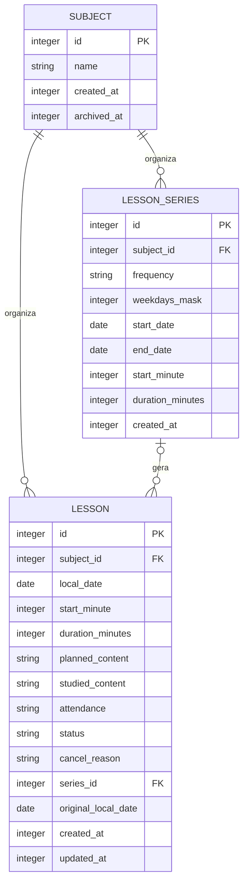

# App móvel — estratégia offline-first

**Estado:** fundação local e boa parte da Fase 1 implementadas (esquema SQLite v2); validação em dispositivo ainda pendente. **Objetivo:** agenda e diário de aulas úteis em modo avião, para aluno que frequenta várias matérias e pode ter muitas aulas num dia.

## Decisões da fundação

1. **Aparelho primeiro:** SQLite local é a fonte de verdade. Nenhum fluxo de aula depende de rede, sessão, conta ou servidor.
2. **Banco relacional pequeno:** matérias são linhas próprias; cada ocorrência de aula liga à matéria. Horários são guardados como data civil local e minutos desde meia-noite, evitando conversões UTC que mudem o dia/horário escolar. A aritmética de datas (`src/features/lessons/domain.ts`) corre em UTC sobre datas civis, para que mudanças de hora de verão nunca desloquem um dia.
3. **Acesso limitado:** a agenda lê uma semana (segunda a domingo, navegável) e no máximo 100 ocorrências. O ecrã de histórico pede páginas de 30 linhas (máximo do repositório: 100) com cursor composto `(local_date, start_minute, id)`. O aviso de sobreposição lê só colunas numéricas, até 2000 linhas no intervalo afetado. Matérias: até 200 linhas. Não carregar todo o histórico em memória.
4. **Sem ficheiros pesados no banco:** texto curto fica no SQLite (conteúdos até 2000 caracteres, nomes até 80); fotos e PDFs não são armazenados em BLOB/base64. Anexos só entram depois com armazenamento no sistema de ficheiros, miniaturas sob demanda e política explícita de cópia de segurança.
5. **Sem expiração automática:** faltas, aulas e anotações escolares não são apagadas para “limpar” o app. Excluir uma aula é sempre uma ação do aluno com confirmação explícita; arquivar uma matéria não apaga aulas. Exportar e apagar todos os dados serão ações controladas pelo utilizador. Leveza vem de consultas paginadas, índices seletivos, listas virtualizadas e evitar imagens pesadas, não de perder histórico.
6. **Escritas pequenas:** cada ação é uma transação SQLite breve; a maior é a criação de uma repetição (até 300 inserções com instrução preparada numa transação). Agenda ordenada e filtros usam índices. WAL permite leitura concorrente com gravações. Cache SQLite do processo é limitado a cerca de 4 MiB neste perfil inicial; medir em aparelhos antes de alterar.
7. **Evolução sem acoplar ao servidor:** regras de domínio puras (`domain.ts`), repositórios (`repository.ts`) e ecrãs (`src/screens`) vivem separados; a interface não executa SQL. A sincronização futura deverá ser uma camada explícita com outbox idempotente, IDs estáveis, resolução de conflitos e consentimento; não uma chamada de rede escondida na gravação local.
8. **Preferências leves:** idioma (pt-BR, pt-PT, en, es) e tema (sistema, claro, escuro) são pequenas chaves locais via `expo-sqlite/kv-store`, sem uma segunda infraestrutura de estado.

## Modelo de dados (esquema v2)

- `attendance` (`unmarked`/`attended`/`absent`) registra somente a perspectiva local do aluno. Para colaboração futura, será substituído/expandido por registros de presença com autoria e confirmação independente; uma pessoa não pode declarar como fato a falta da outra.
- `status` (`planned`/`cancelled`) é o estado da aula, separado da presença. Cancelar limpa a presença para `unmarked` e o repositório recusa presença em aula cancelada: cancelamento nunca conta como falta (nem como presença). Reativar volta a `planned` sem inventar presença.
- `planned_content` (plano) e `studied_content` (o que foi realmente estudado) são campos distintos; o estudado é preenchido na edição.
- `lesson_series` guarda a regra semanal/quinzenal (máscara de dias: bit 0 = domingo … bit 6 = sábado) e o intervalo; as ocorrências são materializadas como linhas de `lessons` com `series_id` e `original_local_date`. Quinzenal conta semanas (segunda a domingo) a partir da semana da data inicial: semanas 0, 2, 4…
- `subjects.archived_at` esconde a matéria das sugestões sem tocar nas aulas; voltar a usar o mesmo nome numa aula reativa-a. Nomes de matéria são únicos sem diferenciar maiúsculas (ASCII).

### Migrações

`src/db/migrations.ts` (sem dependências do Expo) aplica, numa única transação, os passos em falta até `SCHEMA_VERSION = 2` e grava `PRAGMA user_version` no fim; uma falha desfaz tudo e a versão anterior continua intacta. Os PRAGMAs de ligação (WAL, chaves estrangeiras, cache) correm antes, fora da transação, em `src/db/database.ts`.

- **v1:** `subjects`, `lessons`, índices `lessons_date_time_idx` e `lessons_subject_date_idx`.
- **v2 (aditiva):** cria `lesson_series`; `ALTER TABLE lessons ADD COLUMN` `status` (default `planned`, CHECK), `cancel_reason`, `series_id` (FK `ON DELETE SET NULL`), `original_local_date`, `updated_at`; `ALTER TABLE subjects ADD COLUMN archived_at`; índice parcial `lessons_series_date_idx (series_id, local_date) WHERE series_id IS NOT NULL`. Nenhuma linha existente é reescrita ou apagada; os defaults preenchem as aulas antigas.
- Uma base com `user_version` maior do que a app conhece é recusada; nunca se apaga a base para contornar um erro de migração.
- `npm test` executa estas migrações contra `node:sqlite` (SQLite 3.53 do Node 24): base nova, upgrade v1→v2 com dados preservados, rollback com falha injetada e recusa de versão futura. **Ainda falta** confirmar o mesmo no SQLite do expo-sqlite em Android/iOS, com uma base v1 criada pela versão anterior da app.

### Repetições: o que é e não é suportado

| Ação | Suportado | Notas |
|---|---|---|
| Criar repetição semanal/quinzenal | Sim | Dias da semana + data final; até 1 ano e 300 aulas; tudo numa transação. |
| Editar campos de uma ocorrência | Só “esta” | Mantém `series_id` e `original_local_date`. |
| Cancelar | “Só esta” ou “esta e as seguintes” | Seguintes = mesma série com data ≥ à da aula escolhida. |
| Excluir | “Só esta” ou “esta e as seguintes” | Com confirmação; a data final da série é encurtada e a série sem aulas é removida. |
| Editar todas/as seguintes, alterar a regra, estender a série | **Não** | Próximo incremento; exige decisão sobre ocorrências já editadas. |
| Feriados/exceções automáticas | **Não** | Hoje faz-se cancelando a ocorrência. |

### Aviso de sobreposição

Antes de guardar, o editor compara a aula (ou todas as datas da repetição) com as aulas não canceladas do mesmo dia; intervalos que apenas se tocam (15:00–16:00 e 16:00–17:00) não contam. O aviso mostra quantos casos existem e deixa “Guardar mesmo assim” ou “Rever”; nunca bloqueia.

### Histórico e pesquisa local

O histórico mostra aulas até hoje (as futuras ficam na agenda), da mais recente para a mais antiga. As páginas só crescem quando o aluno toca “Carregar mais”; a `FlatList` virtualiza a renderização, mas as páginas carregadas ficam em memória até mudar o filtro (descartar páginas distantes fica para quando houver medição em aparelho).

Pesquisa em matéria, professor, conteúdo planeado e estudado com `LIKE ? ESCAPE '\'`; `%`, `_` e `\` digitados são escapados e o termo é limitado a 100 caracteres. Os filtros opcionais usam parâmetros (`? IS NULL OR …`), nunca SQL concatenado. `LIKE` do SQLite só ignora maiúsculas em ASCII: “FÍSICA” não encontra “Física”. Pesquisa sem acentos/FTS fica para depois de medir volume real.

## Guardrails de crescimento

- Não usar `SELECT *`, resultados sem limite ou consultas por item em loop.
- Todas as entradas SQL usam placeholders; texto de utilizador nunca compõe SQL.
- Índices só nas chaves e filtros usados (`local_date/start_minute`, `subject_id/local_date`, `series_id/local_date` parcial); revisar plano com volume real antes de adicionar índices.
- Evitar guardar estado derivável ou duplicar títulos das matérias em cada aula.
- Nunca manter duas cópias globais do histórico em estado React; carregar páginas sob pedido.
- Não usar polling, analytics ou sincronização automática na fase sem nuvem.
- Não compactar ou eliminar histórico silenciosamente. `wal_checkpoint(PASSIVE)` é uma operação eventual de manutenção, não uma política de apagar informação.
- Investigar consumo real com profiling no Android e Instruments no iOS após instalar em aparelhos; metas de memória/armazenamento ainda não foram medidas e não devem ser inventadas.

## Segurança, privacidade e recuperação

Os dados ficam dentro do sandbox da aplicação e a instalação atual não envia registos. SQLite não está criptografado por esta configuração; não anunciar proteção criptográfica adicional. Antes de guardar informação particularmente sensível ou oferecer contas de menores, rever proteção de ficheiros do iOS/Android, bloqueio do dispositivo, exportação, cópia de segurança e eliminação. A desinstalação ou perda do telefone pode apagar dados nesta versão. Criar exportação/restauro local antes de adicionar sincronização em nuvem.

## Incrementos seguintes

1. Edição de “todas”/“esta e as seguintes” e alteração da regra de série; exceções por feriado; calendário mensal.
2. Cor/ordem das matérias, apontamentos privados, tarefas/revisões; filtro do histórico por período.
3. Exportação/importação com verificação de integridade e eliminação de todos os dados por iniciativa do aluno.
4. Profiling de memória, desempenho e base com conjuntos grandes gerados localmente; medir Android e iOS.
5. Apenas após uma decisão explícita: conta opcional, backup cloud e sincronização idempotente com conflitos visíveis, mantendo a app operável em modo avião.

## Verificação

- `npm run typecheck` (app e ficheiros de teste) e `npm test` devem passar.
- `npx expo-doctor` deve confirmar compatibilidade do SDK.
- `npx expo export --platform android --platform ios` deve gerar os dois bundles.
- Validar manualmente criação e leitura em Android e iPhone reais/emulados, alternando modo avião e reiniciando a aplicação.
- A compilação local para iOS não pode ser feita nesta máquina Windows; a geração/instalação Android depende de SDK ou Expo Go.
