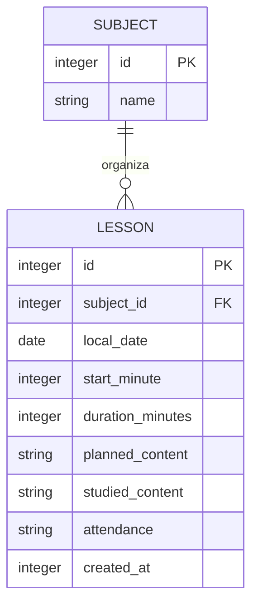

# App móvel — estratégia offline-first

**Estado:** fundação local implementada; validação em dispositivo ainda pendente. **Objetivo:** agenda e diário de aulas úteis em modo avião, para aluno que frequenta várias matérias e pode ter muitas aulas num dia.

## Decisões da fundação

1. **Aparelho primeiro:** SQLite local é a fonte de verdade. Nenhum fluxo de aula depende de rede, sessão, conta ou servidor.
2. **Banco relacional pequeno:** matérias são linhas próprias; cada ocorrência de aula liga à matéria. Horários são guardados como data civil local e minutos desde meia-noite, evitando conversões UTC que mudem o dia/horário escolar.
3. **Acesso limitado:** a agenda lê só uma semana e no máximo 100 ocorrências. O repositório de histórico já oferece páginas de até 100 linhas, com cursor por data. Não carregar todo o histórico em memória.
4. **Sem ficheiros pesados no banco:** texto curto fica no SQLite; fotos e PDFs não são armazenados em BLOB/base64. Anexos só entram depois com armazenamento no sistema de ficheiros, miniaturas sob demanda e política explícita de cópia de segurança.
5. **Sem expiração automática:** faltas, aulas e anotações escolares não são apagadas para “limpar” o app. Arquivar, exportar e apagar dados serão ações controladas pelo utilizador. Leveza vem de consultas paginadas, índices seletivos, listas virtualizadas quando o histórico for construído e evitar imagens pesadas, não de perder histórico.
6. **Escritas pequenas:** cada ação é uma transação SQLite breve; agenda ordenada e filtros usam índices. WAL permite leitura concorrente com gravações. Cache SQLite do processo é limitado a cerca de 4 MiB neste perfil inicial; medir em aparelhos antes de alterar.
7. **Evolução sem acoplar ao servidor:** regras de domínio e repositório vivem separados da tela. A sincronização futura deverá ser uma camada explícita com outbox idempotente, IDs estáveis, resolução de conflitos e consentimento; não uma chamada de rede escondida na gravação local.
8. **Preferências leves:** idioma (pt-BR, pt-PT, en, es) e tema (sistema, claro, escuro) são pequenas chaves locais via `expo-sqlite/kv-store`, sem uma segunda infraestrutura de estado.

## Modelo de dados inicial

`attendance` registra somente a perspectiva local do aluno. Para colaboração futura, será substituído/expandido por registros de presença com autoria e confirmação independente; uma pessoa não pode declarar como fato a falta da outra.

## Guardrails de crescimento

- Não usar `SELECT *`, resultados sem limite ou consultas por item em loop.
- Todas as entradas SQL usam placeholders; texto de utilizador nunca compõe SQL.
- Índices só nas chaves e filtros usados (`local_date/start_minute`, `subject_id/local_date`); revisar plano com volume real antes de adicionar índices.
- Evitar guardar estado derivável ou duplicar títulos das matérias em cada aula.
- Nunca manter duas cópias globais do histórico em estado React; carregar páginas e descartar páginas distantes quando o ecrã for implementado.
- Não usar polling, analytics ou sincronização automática na fase sem nuvem.
- Não compactar ou eliminar histórico silenciosamente. `wal_checkpoint(PASSIVE)` é uma operação eventual de manutenção, não uma política de apagar informação.
- Investigar consumo real com profiling no Android e Instruments no iOS após instalar em aparelhos; metas de memória/armazenamento ainda não foram medidas e não devem ser inventadas.

## Segurança, privacidade e recuperação

Os dados ficam dentro do sandbox da aplicação e a instalação atual não envia registos. SQLite não está criptografado por esta configuração; não anunciar proteção criptográfica adicional. Antes de guardar informação particularmente sensível ou oferecer contas de menores, rever proteção de ficheiros do iOS/Android, bloqueio do dispositivo, exportação, cópia de segurança e eliminação. A desinstalação ou perda do telefone pode apagar dados nesta versão. Criar exportação/restauro local antes de adicionar sincronização em nuvem.

## Incrementos seguintes

1. Editor, exclusão com confirmação, conteúdo estudado e ecrã de histórico paginado.
2. Matérias como entidade editável/arquivável; recorrências com exceções e edição clara do alcance.
3. Pesquisa local paginada e exportação/importação com verificação de integridade.
4. Profiling de memória, desempenho e base com conjuntos grandes gerados localmente; medir Android e iOS.
5. Apenas após uma decisão explícita: conta opcional, backup cloud e sincronização idempotente com conflitos visíveis, mantendo a app operável em modo avião.

## Verificação desta fundação

- `npx tsc --noEmit` deve passar.
- `npx expo-doctor` deve confirmar compatibilidade do SDK.
- Validar manualmente criação e leitura em Android e iPhone reais/emulados, alternando modo avião e reiniciando a aplicação.
- A compilação local para iOS não pode ser feita nesta máquina Windows; a geração/instalação Android depende de SDK ou Expo Go.
